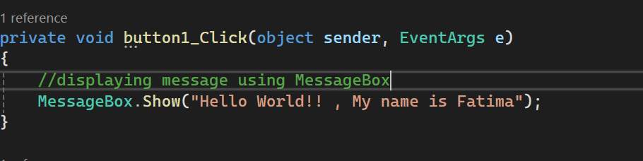
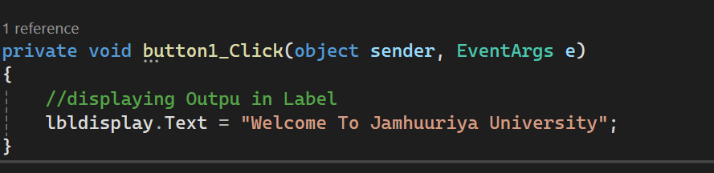
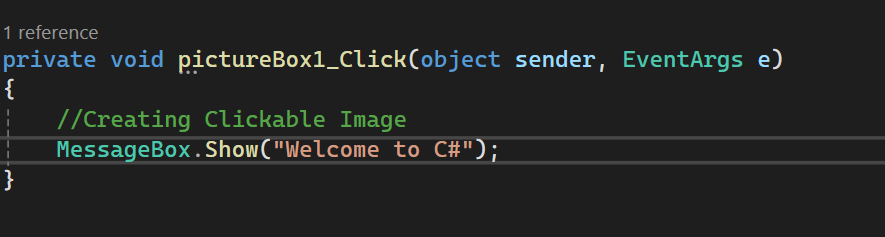
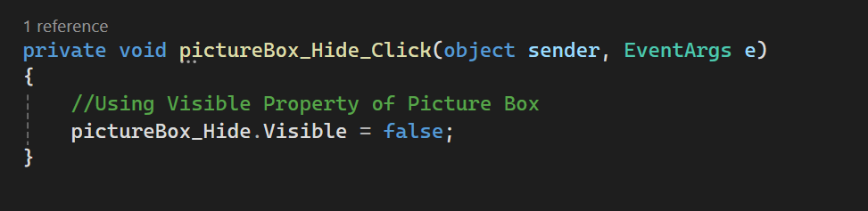
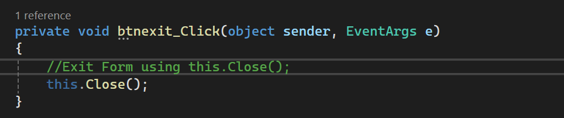

## 1. Displaying a Message Using MessageBox
In this Example,
a button click event is used to display a simple message to the user. When the user clicks the button, the `messagebtn_click` event runs and shows a message box containing "Hello World".

### Output

## Displaying Output in a Label Control

In this Example,
a button click event is used to display text in a Label control. When the user clicks the button, the `btnanswer_Click` event runs and changes the text of `lblanswer` to "Jamhuriya University".

### Output

## Creating a Clickable Image Using PictureBox

In this Example, 
a PictureBox click event is used to make an image clickable. When the user clicks the image, the `pictureboxclick_Click` event runs and displays a message box containing "Welcome to our class".

### Output

## Hiding a PictureBox Using the Visible Property

In this Example, 
the `Visible` property of a PictureBox is used to hide the image. When the user clicks the picture, the `pictureboxgirl_Click` event runs and sets `pictureboxgirl.Visible` to `false`, making the picture disappear.

### Output

## Closing the Form Using the Close Method

In this Example, 
the `Close()` method is used to close the current form. When the user clicks the button, the `btnclose_Click` event runs and `this.Close()` closes the application window.

### Output

