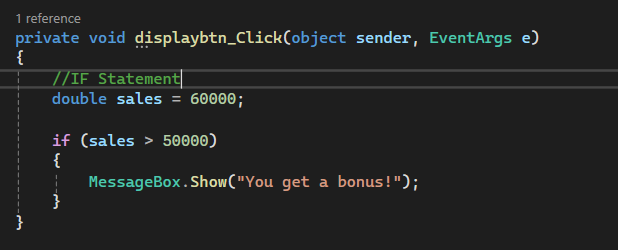
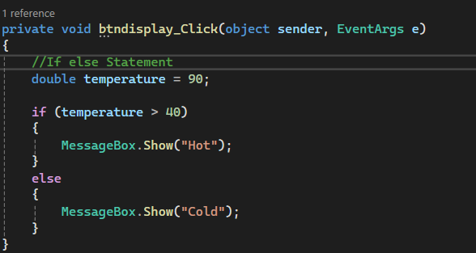
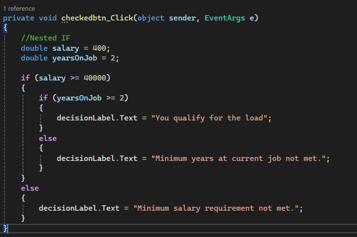
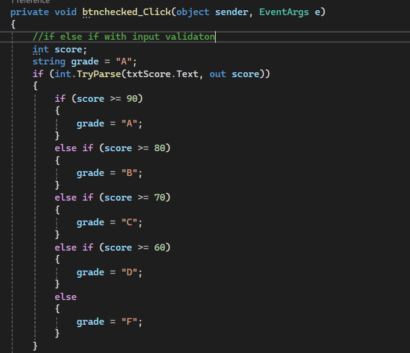
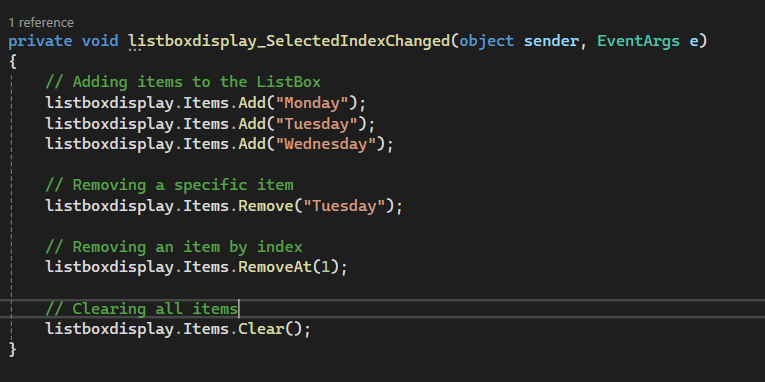

## If Statement  

An `if` statement checks a condition and runs its statements only when the condition is true.

### How the Code Works

- `sales > 50000` checks whether sales are greater than 50,000.
- If the condition is true, `bonus` becomes 500.
- If false, the assignment is skipped.

```csharp
private void checkButton_Click(object sender, EventArgs e)
{
    double sales = 60000;

    if (sales > 50000)
    {
        MessageBox.Show("You get a bonus!");
    }
}

```
## Code
;

## If-else Statement
An `if-else` statement chooses between two possible actions.

### How the Code Works

- `Temp` starts at 90.
- The condition checks whether the temperature is greater than 40.
- The `if` branch runs when true; otherwise the `else` branch runs.
- The slide displays `"hot"` in both branches, so both paths show the same message.


```csharp
private void checkButton_Click(object sender, EventArgs e)
{
    double temperature = 90;

    if (temperature > 40)
    {
        MessageBox.Show("Hot");
    }
    else
    {
        MessageBox.Show("Cold");
    }
}
```
## Code



## Nested IF
Nested decisions place one decision inside another. The chapter uses a loan qualification example.


```csharp

double salary = 400;
double yearsOnJob = 2;

if (salary >= 40000)
{
    if (yearsOnJob >= 2)
    {
        decisionLabel.Text = "You qualify for the load";
    }
    else
    {
        decisionLabel.Text = "Minimum years at current job not met.";
    }
}
else
{
    decisionLabel.Text = "Minimum salary requirement not met.";
}
```



## If-else-if Statement and input validation

This decision structure checks several conditions in order and selects the first matching branch.

### How the Code Works

- `int.TryParse` returns true when the text can be converted to an integer.
- `out score` receives the converted value.
- Scores of 90 or more receive A, then the next conditions test 80, 70, and 60.
- If no condition matches, the grade is F.

### Code

```csharp
int score ; 
string grade = "A";
if (int.TryParse(textScore.Text, out score)){
    if (score >= 90)
{
    grade = "A";
}
else if (score >= 80)
{
    grade = "B";
}
else if (score >= 70)
{
    grade = "C";
}
else if (score >= 60)
{
    grade = "D";
}
else
{
    grade = "F";
}
}

```




## ListBox: Adding, Removing, and Clearing Items
A ListBox is a control that displays a list of items. The `Items.Add` method adds new items, while `Items.Remove`, `Items.RemoveAt`, and `Items.Clear` are used to remove items from the ListBox.

### How the Code Works

- **`Items.Add()`** – Adds a new item to the ListBox.
- **`Items.Remove()`** – Removes a specific item by its value.
- **`Items.RemoveAt()`** – Removes an item using its index (starting from 0).
- **`Items.Clear()`** – Removes all items from the ListBox.
- An invalid index in `RemoveAt()` causes an exception.

### Code

```csharp
// Adding items to the ListBox
daysListBox.Items.Add("Monday");
daysListBox.Items.Add("Tuesday");
daysListBox.Items.Add("Wednesday");

// Removing a specific item
daysListBox.Items.Remove("Tuesday");

// Removing an item by index
daysListBox.Items.RemoveAt(1);

// Clearing all items
daysListBox.Items.Clear();
```

