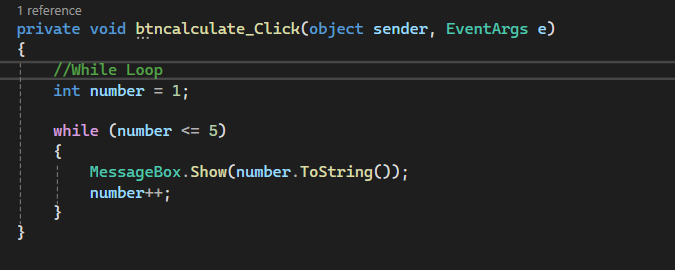
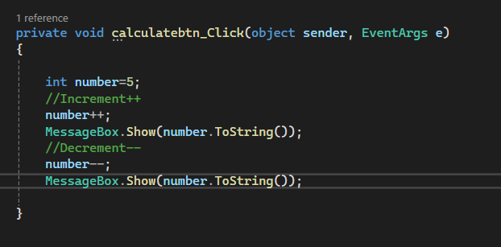
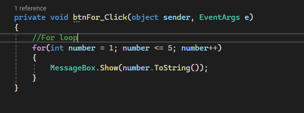
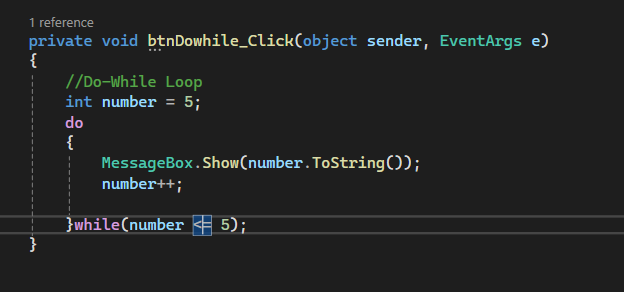

## While Loop
A **while loop** is a repetition structure that executes a block of statements repeatedly as long as a condition remains true. It is a pretest loop, meaning the condition is checked before each repetition. If the condition is false at the beginning, the loop will not execute.

## Code
```csharp
int number = 1;

while (number <= 5)
{
    MessageBox.Show(number.ToString());
    number++;
}
```


## Increment and Decrement Operators
The **increment (++) and decrement (--)** operators are used to increase or decrease a variable by 1. They are commonly used to control loop counters and help determine when a loop should stop.

## Code
```csharp
int number = 5;

number++;
MessageBox.Show(number.ToString());

number--;
MessageBox.Show(number.ToString());

```



## for Loop
A **for loop** is a repetition structure commonly used when the number of repetitions is known. It combines three important parts: initialization, condition, and update. The condition is checked before each repetition, and the counter is updated after each repetition.

## Code
```csharp
for (int number = 1; number <= 5; number++)
{
    MessageBox.Show(number.ToString());
}

```


## do-while Loop
A **do-while loop** is a repetition structure that executes a block of statements before checking its condition. It is a posttest loop, meaning the condition is checked after each repetition. Therefore, the loop always executes at least once, even if the condition is initially false.

## Code
```csharp
int number = 1;

do
{
    MessageBox.Show(number.ToString());
    number++;
}
while (number <= 5);

```

